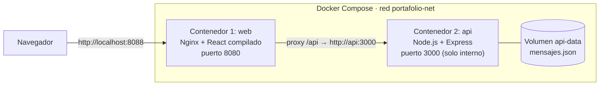

# Portafolio personal con Docker e integración continua

Portafolio de Oscar Thomas Castro Suárez (React + Vite + Tailwind) dividido en **dos contenedores Docker que se comunican entre sí**, orquestados con Docker Compose y verificados en cada push con GitHub Actions.

Entrega 1 (semana 3) del módulo Énfasis Profesional I (Integración Continua), Politécnico Grancolombiano.

## Arquitectura



| Contenedor | Imagen base | Función | Puerto |
|---|---|---|---|
| `web` | `node:22-alpine` (build) → `nginxinc/nginx-unprivileged:1.27-alpine` | Sirve el portafolio y reenvía `/api` al contenedor `api` | 8088 (host) → 8080 |
| `api` | `node:22-alpine` | Entrega los proyectos y guarda los mensajes de contacto | 3000, solo en la red interna |

**Comunicación:** el portafolio pide `/api/projects` al contenedor `web`; Nginx reenvía la petición a `http://api:3000` usando el DNS interno de Docker (nombre del servicio). La API no publica puertos en el host, así que solo se puede llegar a ella a través de la red `portafolio-net`.

## Endpoints de la API

| Método | Ruta | Descripción |
|---|---|---|
| GET | `/api/health` | Estado del servicio y nombre del contenedor |
| GET | `/api/projects` | Lista de proyectos que muestra el portafolio |
| GET | `/api/contact` | Total de mensajes guardados |
| POST | `/api/contact` | Guarda un mensaje `{ nombre, email, mensaje }` en el volumen |

## Cómo ejecutarlo

Requisitos: Docker Desktop (Docker Compose v2).

```bash
git clone https://github.com/ThomasCastro2005/personal-portafolio.git
cd personal-portafolio
cp .env.example .env
docker compose up -d --build
docker compose ps
```

Abrir http://localhost:8088. La sección *Projects* muestra «Estado de la API: conectada» y los proyectos que entrega el contenedor `api`.

### Pruebas de comunicación

```bash
# Del contenedor web al contenedor api por la red interna
docker compose exec web wget -qO- http://api:3000/api/health

# Desde el host, pasando por el proxy de Nginx
curl http://localhost:8088/api/health
curl http://localhost:8088/api/projects
curl -X POST http://localhost:8088/api/contact -H "Content-Type: application/json" \
  -d '{"nombre":"Prueba","email":"prueba@example.com","mensaje":"Hola"}'

# Logs: las peticiones llegan a la API desde la IP del contenedor web
docker compose logs api
```

Detener: `docker compose down` (añadir `-v` para borrar también el volumen).

## Buenas prácticas de seguridad aplicadas

- Imágenes base `alpine` (superficie de ataque reducida) y build multi-etapa: la imagen final de `web` no lleva Node ni el código fuente.
- Ambos contenedores corren **sin root** (`USER node` y `nginx-unprivileged`).
- La API **no publica puertos** en el host; solo es accesible dentro de `portafolio-net`.
- `api` con sistema de archivos de solo lectura (`read_only`), `cap_drop: ALL` y `no-new-privileges`; solo escribe en su volumen.
- Variables de entorno en `.env` (ignorado por git); se versiona solo `.env.example`.
- `.dockerignore` para no copiar `node_modules`, `.git` ni `.env` a las imágenes.
- Cabeceras de seguridad (`X-Content-Type-Options`, `X-Frame-Options`, `Referrer-Policy`), `server_tokens off` y sin `X-Powered-By`.
- Validación de entrada y límite de 10 kB en el cuerpo de las peticiones.
- Healthchecks en ambos contenedores; `web` espera a que `api` esté sano (`depends_on: service_healthy`).

## Integración continua (GitHub Actions)

El workflow [`.github/workflows/ci.yml`](.github/workflows/ci.yml) se ejecuta en cada push y pull request:

1. Instala dependencias, ejecuta ESLint y compila el frontend.
2. Valida la sintaxis de la API y el `docker-compose.yml`.
3. Construye y levanta los dos contenedores esperando a que estén sanos.
4. Prueba la comunicación `web → api` por la red interna y a través del proxy de Nginx.
5. Comprueba que la API no esté expuesta en el host.
6. Muestra los logs y apaga los contenedores.

## Desarrollo local sin Docker

```bash
npm install && npm run dev          # frontend en http://localhost:5173
cd api && npm install && npm start  # API en http://localhost:3000 (Vite redirige /api)
```
